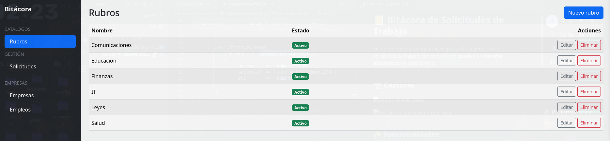
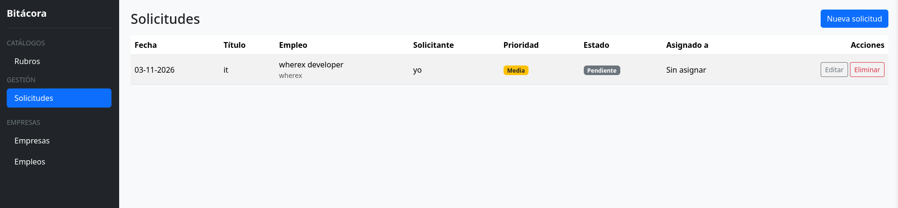

# 📒 Bitácora de Solicitudes de Trabajo

Sistema interno para registrar, asignar y dar seguimiento a solicitudes de trabajo, con conteos por estado y un **historial automático** de cada cambio.

---

## 📸 Capturas





---

## ✨ Funcionalidades

- CRUD de solicitudes (título, descripción, solicitante, prioridad, estado, asignado a, fecha de cierre).
- Estados: pendiente, en proceso, terminada.
- **Historial automático**: cada vez que se crea o modifica una solicitud se guarda una fila por cada campo cambiado (valor anterior y valor nuevo).
- Filtros y conteos por estado, fecha y responsable.
- Autenticación y roles de usuario.

## 🧱 Stack

| Capa | Tecnología |
|------|------------|
| Backend | PHP + Laravel |
| Frontend | Vistas Blade de Laravel (no requiere compilar assets) |
| Base de datos | SQLite (un archivo local, sin servidor) |
| Control de versiones | Git + GitHub |

---

## 📋 Requisitos previos

Instala lo siguiente **antes** de empezar (no hace falta Node, npm ni un servidor de base de datos):

| Herramienta | Versión recomendada | Para qué sirve |
|-------------|--------------------|----------------|
| PHP | 8.2 o superior | Ejecutar Laravel |
| Composer | 2.x | Instalar dependencias PHP |
| Git | cualquiera reciente | Clonar el repo |

Extensiones de PHP necesarias: `mbstring`, `xml`, `curl`, `zip`, `bcmath`, `fileinfo`, `openssl`, `tokenizer`, `ctype`, **`pdo_sqlite`** y **`sqlite3`**.

Comprueba tus versiones y que SQLite esté activo:

```bash
php -v
composer -V
git --version
php -m | grep -i sqlite    # debe mostrar pdo_sqlite y sqlite3
```

<details>
<summary><b>Instalar requisitos según tu sistema</b></summary>

**Arch / CachyOS / Manjaro**
```bash
sudo pacman -S php composer git
sudo pacman -S php-sqlite
```
Luego abre `/etc/php/php.ini` y descomenta (quita el `;` de) estas líneas:
```ini
extension=pdo_sqlite
extension=sqlite3
```

**Ubuntu / Debian**
```bash
sudo apt update
sudo apt install php php-cli php-mbstring php-xml php-curl php-zip php-bcmath php-sqlite3 composer git
```

**macOS (Homebrew)**
```bash
brew install php composer git
```
(PHP de Homebrew ya incluye SQLite.)

**Windows**
Lo más simple es usar [Laragon](https://laragon.org/), que trae PHP y Composer ya configurados. Si usas PHP a mano, activa `pdo_sqlite` y `sqlite3` en `php.ini`.
</details>

---

## 🚀 Instalación paso a paso

### 1. Clonar el repositorio

Desde la página del repositorio en GitHub, copia la URL (botón verde **Code**) y ejecuta:

```bash
git clone <URL-del-repositorio>
cd bitacora
```

### 2. Instalar dependencias de PHP

```bash
composer install
```

### 3. Crear el archivo de entorno

```bash
cp .env.example .env
```

En Windows (CMD): `copy .env.example .env`

### 4. Generar la clave de la aplicación

```bash
php artisan key:generate
```

### 5. Crear la base de datos (SQLite)

SQLite guarda toda la base en un solo archivo, así que no hay que instalar ni configurar ningún servidor. Solo crea el archivo vacío:

```bash
touch database/database.sqlite
```

En Windows (CMD): `type nul > database\database.sqlite`

Revisa que tu `.env` apunte a SQLite (es lo que trae `.env.example` por defecto):

```env
DB_CONNECTION=sqlite
```

> Si en tu `.env` aparecen otras líneas `DB_HOST`, `DB_DATABASE`, `DB_USERNAME` o `DB_PASSWORD`, puedes ignorarlas o borrarlas: SQLite no las usa.

### 6. Ejecutar migraciones

```bash
php artisan migrate
```

Esto crea las tablas: usuarios, solicitudes e historial (con `usuario_id` nullable y `valor_anterior` / `valor_nuevo` como `text`).

> Si no creaste el archivo en el paso anterior, Laravel te preguntará si quieres crearlo. Responde **yes**.

Si el proyecto incluye seeders con datos de prueba:

```bash
php artisan migrate --seed
```

### 7. Levantar el servidor

```bash
php artisan serve
```

Abre http://localhost:8000 en tu navegador. 🎉

---

## 👤 Crear un usuario para entrar

Si no hay seeders, crea un usuario desde Tinker:

```bash
php artisan tinker
```

```php
\App\Models\User::create([
    'name' => 'Admin',
    'email' => 'admin@example.com',
    'password' => bcrypt('password123'),
]);
```

> Si el proyecto usa roles u otros campos obligatorios, agrégalos al arreglo. Cambia la contraseña en cuanto sea posible.

---

## 🗂️ Cómo funciona el historial automático

El historial se genera con un **Observer de Eloquent** (`SolicitudObserver`), por lo que no hay que llamarlo manualmente desde los controladores:

- Al **crear** una solicitud se registra una fila de tipo "creada".
- Al **editar**, se registra **una fila por cada campo modificado**, con valor anterior y valor nuevo.
- Se **ignoran** los campos `created_at`, `updated_at` y `fecha_cierre`.
- Si el usuario que hizo el cambio se elimina, el registro se conserva (`usuario_id` pasa a `null`).

Para que funcione, el observer debe estar registrado (en `AppServiceProvider` o con el atributo `#[ObservedBy]` en el modelo `Solicitud`). Si no ves historial al editar, revisa eso primero.

---

## 🛠️ Comandos útiles

```bash
php artisan migrate:fresh --seed   # Reinicia la BD desde cero (borra todos los datos)
php artisan optimize:clear         # Limpia cachés de config, rutas y vistas
php artisan route:list             # Lista todas las rutas
php artisan tinker                 # Consola interactiva
php artisan test                   # Ejecuta los tests
```

Para empezar de cero también basta con borrar `database/database.sqlite`, crearlo de nuevo y correr `php artisan migrate`.

---

## 🧯 Problemas comunes

| Problema | Solución |
|----------|----------|
| `could not find driver` | Falta la extensión `pdo_sqlite`. Instálala y actívala en `php.ini`. |
| `Database file ... does not exist` | Crea el archivo: `touch database/database.sqlite`. |
| `unable to open database file` | La ruta es incorrecta o faltan permisos sobre la carpeta `database/`. Prueba `chmod -R 775 database`. |
| `attempt to write a readonly database` | El archivo o la carpeta `database/` no tienen permiso de escritura para tu usuario. |
| `No application encryption key has been specified` | Ejecuta `php artisan key:generate`. |
| Cambios del `.env` no se aplican | Ejecuta `php artisan optimize:clear`. |
| Estilos rotos o sin cargar | Revisa tu conexión a internet si las vistas cargan librerías por CDN. |
| Error de permisos en `storage/` | `chmod -R 775 storage bootstrap/cache` |

---


## 📄 Licencia

MIT
